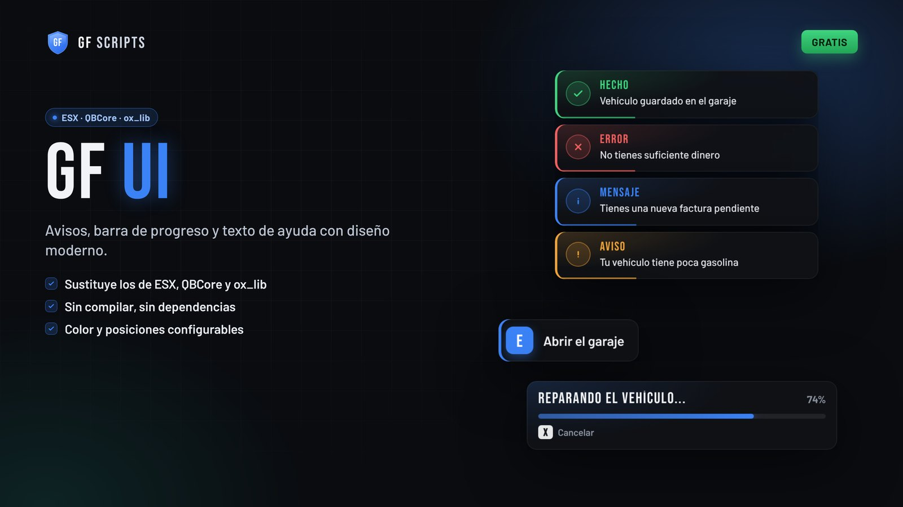
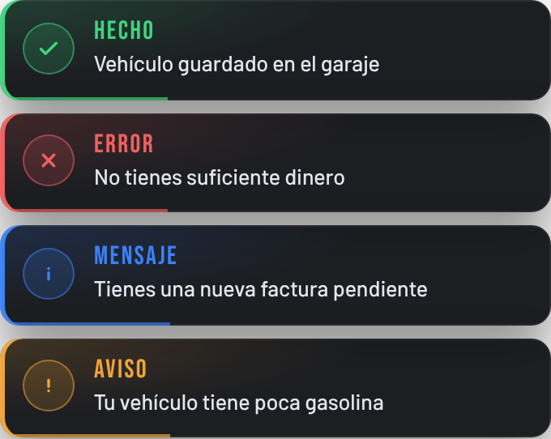
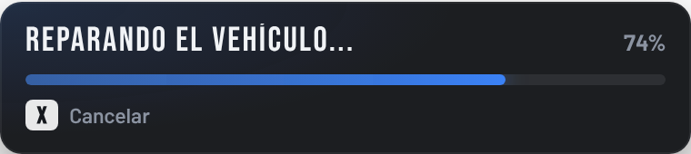

# GF UI · Avisos, barra de progreso y texto de ayuda para FiveM



**[English version](README.en.md)** · **[⬇ Descargar la última versión](../../releases/latest)** · [Web](https://gfscripts.github.io) · [Discord](https://discord.gg/nR78WKsqf)

GF UI es una interfaz **gratis y de código abierto** de **GF Scripts** para tu servidor de FiveM. Cambia tres cosas que se ven constantemente:

- **Avisos** (notificaciones): "Vehículo guardado", "No tienes dinero"...
- **Barra de progreso**: "Reparando el vehículo... 74 %".
- **Texto de ayuda**: `[E] Abrir garaje`.

Todo con el mismo diseño. Funciona con **ESX**, **QBCore** y sin framework. No hay que compilar nada ni instalar dependencias.

## Capturas

| Avisos | Barra de progreso | Texto de ayuda |
|---|---|---|
|  |  |  |

<!--
  CAPTURAS DENTRO DEL JUEGO: cuando las tengas, guárdalas en la carpeta docs con estos nombres
  y borra la primera y la última línea de este bloque (las que abren y cierran el comentario).

| En el juego: avisos | En el juego: barra | En el juego: texto |
|---|---|---|
|  |  |  |
-->

## Instalación paso a paso

1. Descarga el archivo `gf-ui-1.0.0.zip` desde [Releases](../../releases/latest) y descomprímelo.
2. Copia la carpeta **`gf-ui`** dentro de la carpeta `resources` de tu servidor.
3. Abre tu `server.cfg` y añade esta línea **antes** de tu framework (ESX o QBCore) y del resto de scripts:
   ```
   ensure gf-ui
   ```
4. Reinicia el servidor.
5. Entra al juego y escribe **`/gfui_demo`** en el chat. Deben salir cuatro avisos, el texto de ayuda y una barra de progreso.
6. Cuando todo funcione, abre `gf-ui/config.lua` y pon `Config.Debug = false` para quitar el comando de prueba.

Hasta aquí, GF UI ya funciona para los scripts que lo usen directamente. Para que **todo tu servidor** use este diseño, sigue los pasos de tu framework.

### ESX

En la carpeta `compatibilidad/esx` hay tres recursos que sustituyen a los de ESX:

| Carpeta | Qué cambia |
|---|---|
| `esx_notify` | `ESX.ShowNotification` y `xPlayer.showNotification` |
| `esx_progressbar` | `ESX.Progressbar` |
| `esx_textui` | `ESX.TextUI` y `ESX.HideUI` |

1. Busca en tu servidor las carpetas `esx_notify`, `esx_progressbar` y `esx_textui` (suelen estar en `resources/[core]`).
2. **Haz una copia de seguridad** de esas tres carpetas, por si quieres volver atrás.
3. Sustitúyelas por las de `compatibilidad/esx`, con el mismo nombre.
4. Reinicia el servidor.

### QBCore

**Barra de progreso:** sustituye la carpeta `progressbar` por `compatibilidad/qbcore/progressbar`. `gf-ui` tiene que arrancar antes.

**Avisos:** abre `qb-core/client/functions.lua`, busca `function QBCore.Functions.Notify` y cambia **toda la función** por esta:

```lua
function QBCore.Functions.Notify(text, texttype, length, icon)
    local title, message = nil, text
    if type(text) == 'table' then
        title, message = text.caption, text.text
    end
    exports['gf-ui']:Notify({ type = texttype, title = title, description = message, duration = length })
end
```

**Texto de ayuda (opcional):** en `qb-core/client/drawtext.lua`, cambia las funciones `hideText`, `drawText` y `changeText` por:

```lua
local function hideText()
    exports['gf-ui']:HideText()
end

local function drawText(text, position)
    exports['gf-ui']:ShowText(text, { position = (position == 'right' and 'right') or 'left' })
end

local function changeText(text, position)
    drawText(text, position)
end
```

> Si actualizas qb-core, estos cambios se pierden y hay que volver a hacerlos.

### ox_lib (recomendado)

Muchos scripts usan los avisos, barras y textos de **ox_lib**, no los de ESX ni QBCore. Para que también salgan con este diseño, sigue [`compatibilidad/OX_LIB.md`](compatibilidad/OX_LIB.md): son unas líneas en tres archivos de ox_lib.

## Configuración

Todo está en `gf-ui/config.lua`:

| Opción | Qué hace |
|---|---|
| `Config.Color` | Color principal en formato `#rrggbb` (por ejemplo `'#3b82f6'`) |
| `Config.Debug` | `true` activa `/gfui_demo` para probar |
| `Config.Notify.position` | `'top'`, `'top-right'`, `'center-right'`, `'bottom-right'` o `'top-left'` |
| `Config.Notify.duration` | Milisegundos que dura un aviso si no se indica otra cosa |
| `Config.Notify.sound` | Sonido al aparecer un aviso |
| `Config.Notify.titles` | Título de cada tipo de aviso (cámbialos para otro idioma) |
| `Config.Progress.position` | `'bottom'` o `'center'` |
| `Config.Progress.cancelControl` / `cancelKey` | Tecla para cancelar la barra (por defecto X) |
| `Config.Text.position` | `'left'`, `'right'` o `'bottom'` |

El diseño está en `gf-ui/html/style.css`: es CSS normal y lo puedes cambiar.

## Compatibilidad

| | Estado |
|---|---|
| ESX Legacy (`esx_notify`, `esx_progressbar`, `esx_textui`) | ✅ Con las carpetas de `compatibilidad/esx` |
| QBCore (avisos, `progressbar`, drawtext) | ✅ Con la carpeta y las funciones de arriba |
| ox_lib (`lib.notify`, `lib.progressBar`, `lib.progressCircle`, `lib.showTextUI`) | ✅ Con [`OX_LIB.md`](compatibilidad/OX_LIB.md) |
| Qbox | ⚠️ Usa los avisos de ox_lib, así que debería ir con `OX_LIB.md`. **Sin probar** |
| Sin framework | ✅ Con los exports de abajo |

Notas:
- La barra de progreso circular de ox_lib (`progressCircle`) sale como barra normal.
- En ESX, la barra se puede cancelar con X. Si un script de ESX no lo tiene en cuenta, la acción simplemente no se completa.

## Usarlo en tus scripts

**Cliente**

```lua
-- Aviso: type = 'success' | 'error' | 'inform' | 'warning'
exports['gf-ui']:Notify({ type = 'success', title = 'Garaje', description = 'Vehículo guardado', duration = 5000 })

-- Barra de progreso: devuelve true si termina y false si se cancela
local ok = exports['gf-ui']:Progress({
    duration = 5000,
    label = 'Reparando el vehículo...',
    canCancel = true,
    disable = { move = true, car = true, combat = true },
    anim = { dict = 'mini@repair', clip = 'fixing_a_ped' },   -- o { scenario = 'WORLD_HUMAN_WELDING' }
    prop = { model = 'prop_tool_spanner01', bone = 57005, pos = vec3(0.1, 0.0, 0.0), rot = vec3(0.0, 0.0, 0.0) },
})

exports['gf-ui']:CancelProgress()
exports['gf-ui']:IsProgressActive()

exports['gf-ui']:ShowText('[E] Abrir garaje')                       -- la tecla sale en un recuadro
exports['gf-ui']:ShowText('Abrir garaje', { key = 'E', position = 'right' })
exports['gf-ui']:HideText()
exports['gf-ui']:IsTextShown()
```

**Servidor**

```lua
exports['gf-ui']:Notify(source, { type = 'error', description = 'No tienes permiso' })
-- o
TriggerClientEvent('gf-ui:notify', source, { type = 'inform', description = 'Hola' })
```

## Soporte

- **Discord:** [discord.gg/nR78WKsqf](https://discord.gg/nR78WKsqf)
- **Errores:** abre un [issue](../../issues) en este repositorio.

Para que te podamos ayudar, cuenta:
1. Tu framework y su versión (ESX Legacy, QBCore, Qbox...).
2. Qué has hecho y qué esperabas que pasara.
3. Lo que sale en **rojo** en la consola del servidor o en la F8 del juego (una captura vale).

GF UI es gratis: el soporte es en nuestro tiempo libre y puede tardar.

## Licencia

El código es [MIT](LICENSE): lo puedes usar, cambiar y compartir, también en servidores con donaciones, siempre que mantengas el aviso de copyright. Las fuentes (Barlow y Bebas Neue) van con la licencia SIL Open Font License 1.1: mira `gf-ui/LICENCIAS/FUENTES.txt`.

---

Hecho por **GF Scripts**. Mira también **GF Police** (tablet policial) y **GF Radio** en nuestra [web](https://gfscripts.github.io).

GF Scripts no está afiliado a Rockstar Games, Take-Two Interactive ni Cfx.re.
